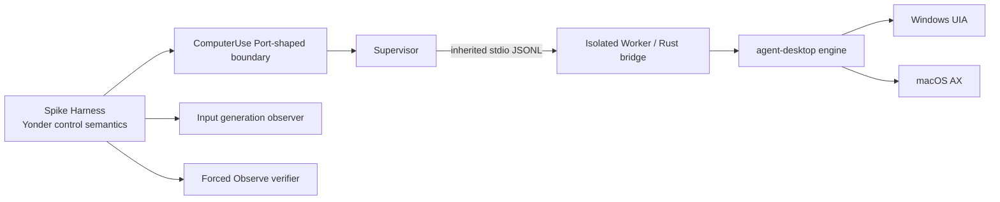

# Architecture Spine — agent-desktop Driver Spike

## Design Paradigm

六边形端口/适配器保持 Application 语义稳定，候选引擎只存在于 Adapter 内部；受监管独立 Worker 隔离最小 Rust bridge、平台故障和强制终止。

## Inherited Invariants

| Inherited | From parent | Binds here |
| --- | --- | --- |
| CUA Driver 模型无关，Application 拥有协调 | ARCHITECTURE-SPINE / AD-CU-04 | ADS-01～03、10 |
| 用户输入冻结新动作，每步强制 Observe | ARCHITECTURE-SPINE / AD-CU-02 / AD-TM-08 | ADS-03～05 |
| 超时、断连、崩溃或交付不明为 unknown 且不重试 | AD-CU-04 / AD-TM-08 | ADS-05、07 |
| 当前 trycua 基线在后继 Accepted ADR 前不变 | AD-E0-02 / AD-CU-01 | ADS-10 |

## Invariants & Rules

### AD-1 — 候选引擎只在受监管 Worker 内运行

- **Binds:** ADS-01、ADS-02
- **Prevents:** Desktop 主进程被卡住的 Driver 调用拖死，或候选引擎成为第二个长期服务与协议入口。
- **Rule:** 唯一入口是独立 Worker 内的最小 Rust bridge，通过继承 stdio 传输版本化 JSONL；禁止 status-only C ABI/CLI、其他 IPC、主进程加载、上游 MCP、CDP 和任何 HTTP/TCP 监听。

### AD-2 — Yonder 控制平面保持唯一

- **Binds:** ADS-02、ADS-04、ADS-05、ADS-10
- **Prevents:** 上游 interaction lease、命令模型或结果状态替代 Yonder 的任务状态、租约、取消和恢复事实。
- **Rule:** Spike harness 只能模拟既有 ComputerUse Port；任务级 lease/fencing、input generation、cancel、deadline、Observe 与 unknown 映射由 Yonder 语义持有，上游模型不得进入 Domain、Gateway 或持久化。

### AD-3 — 目标不确定时拒绝派发

- **Binds:** ADS-03、ADS-06
- **Prevents:** 同名窗口、句柄复用、前台漂移或 hit-test 不明导致误投递。
- **Rule:** 只允许 snapshot、qualified ref 和已验证窗口操作；每次派发前复核 fencing、generation、ref 与平台身份，任一 stale、ambiguous 或 unknown 都 fail closed；禁止 raw 坐标、无目标按键和 `--force`。

### AD-4 — 人类输入先冻结后停止

- **Binds:** ADS-04
- **Prevents:** 用户已经接管时仍派发下一动作，或为检测抢占而记录敏感输入正文。
- **Rule:** 平台观察器维护宿主会话级 `u64` generation 和 `driver_current_attempt | user | unknown | observer_lost`；只有绑定当前 attempt/Worker 的合成事件可忽略，其余分类及 observer 未 ready/重启/回退都递增 generation、冻结派发。固定样本中用户事件与当前 attempt 合成事件均须零漏分、零误分，否则淘汰。

### AD-5 — 派发与抢占共享唯一线性化点

- **Binds:** ADS-04、ADS-05
- **Prevents:** generation/fencing 检查后等待 lease 或写 Worker 时仍发生检查后派发竞态。
- **Rule:** 派发、用户抢占和取消共用 Application-owned admission gate；完整动作帧写入并 flush 到绑定 attempt/Worker 的 inherited stdio 是唯一线性化点。此前为 not-dispatched，此后为 in-flight；上游 lease 等待发生在 Worker 收帧之后。

### AD-6 — 在途终止永不伪装成确定取消

- **Binds:** ADS-05、ADS-07
- **Prevents:** 进程退出被误当成物理副作用回滚，进而自动重试或释放不安全占用。
- **Rule:** 未派发及步骤间可确定取消；动作进入 Driver 后终止 Worker，只要可能交付就必须 unknown 且不重试。Worker 必须由 Job Object/受监管进程组 containment；清理只允许无副作用只读探针，禁止合成补偿输入。残留或无法证明释放时进入 global desktop quarantine，直至宿主重启或明确只读恢复程序通过。

### AD-7 — Driver 返回必须由 Observe 闭环

- **Binds:** ADS-03、ADS-05、ADS-08
- **Prevents:** 动作调用成功、部分 disposition 或进程退出被提升为任务成功事实。
- **Rule:** 正常动作后强制新 snapshot/Observe；只有相同目标身份下的预期条件验证才是已知结果。`delivered_unverified`、Observe 失败、断连、deadline、身份不一致或 disposition 丢失一律 unknown 且不重试。

### AD-8 — 证据 schema 与 Observe oracle 跨平台一致

- **Binds:** ADS-03、ADS-06、ADS-08
- **Prevents:** 两个平台使用同名字段却以不同 predicate、target identity 或 outcome 语义判定通过。
- **Rule:** 每条证据遵循 `agent-desktop-spike-evidence/v1`，包含版本/制品、platform/arch、sample/predicate、attempt/worker/fence、generation、dispatch boundary、delivery、Observe identity/predicate、cleanup 与 outcome 封闭枚举；样本开跑前冻结不含敏感正文的 predicate 和独立只读 target identity oracle。

### AD-9 — 双平台硬门槛不可用评分抵消

- **Binds:** ADS-08、ADS-09、ADS-10
- **Prevents:** 用单平台或多数样本通过掩盖误投递、抢占失效、残留资源或不可分发等安全失败。
- **Rule:** Windows/macOS 使用同一 revision、bridge schema、样本 ID 和判定字段；任一硬淘汰条件命中即候选整体 Rejected，不保留单平台采用出口。双平台与独立验证全通过也只允许更新 ADR，产品接线必须另建 Story/OpenSpec。

## Stack

| Name | Version |
| --- | --- |
| agent-desktop | d3dc190afbf34cd2377252398ddd5c30efbd093a（v1.1.0） |
| Worker bridge | agent-desktop-spike-bridge/v1，JSONL over inherited stdio |
| Evidence | agent-desktop-spike-evidence/v1 |
| Yonder Spike harness | 首次原生运行前写入 build manifest 的不可变 commit + dirty diff hash |
| Windows | Windows 10 1809+ / Windows 11 验证机 |
| macOS | macOS 13+ 验证机 |

## Structural Seed

## Capability → Architecture Map

| Capability / Area | Lives in | Governed by |
| --- | --- | --- |
| ADS-01～02 隔离与唯一控制面 | Harness / Supervisor / Worker | AD-1、AD-2 |
| ADS-03、06 可信动作与目标 | Adapter allowlist / identity guard | AD-3、AD-7、AD-8 |
| ADS-04 人类输入抢占 | Platform input observer / Harness | AD-4 |
| ADS-05、07 取消与清理 | Supervisor / result mapper | AD-5、AD-6 |
| ADS-08～10 双平台结论门禁 | Evidence matrix / ADR | AD-8、AD-9 |

## Deferred

- 产品 Adapter、Gateway、协议、SQLite 和 UI 接线：只有后继 Accepted ADR 与 Apply Story 才能决定。
- 最终采用双平台共享引擎或淘汰：由本 Spike 证据决定；不允许以本 Story 建立单平台长期双栈。
- 产品 Worker 私有消息字段：Spike 固定 bridge/evidence schema 仅作为测试契约；若进入产品，仍须由 Rust 类型生成且不得直接复用手写 Spike schema。
- 生产签名证书、发布渠道和更新迁移：本 Spike 只证明 Yonder 自建、签名/公证和干净机责任链可行，不变更当前发布流程。
